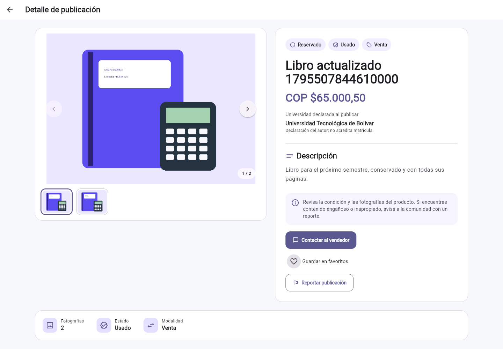
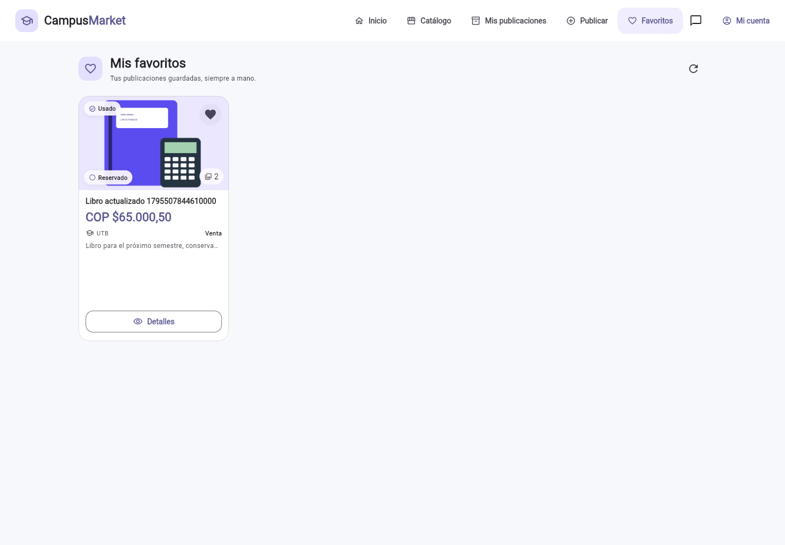

# CampusMarket

**Entrega S17 · 27 de noviembre.** [Matriz de retroalimentación](docs/cierre-arquitectonico/matriz-retroalimentacion.md) · [Evidencias y auditoría](docs/cierre-arquitectonico/evidencias-cierre.md) · [Retrospectiva](docs/cierre-arquitectonico/retrospectiva.md).

CampusMarket reúne las ofertas de venta y alquiler de estudiantes de Cartagena en un catálogo universitario. Un libro anunciado en un grupo de chat puede perderse entre mensajes. Aquí se puede buscar por título, precio o universidad, ver fotografías y conversar con quien lo publicó. El vendedor conserva el control del anuncio y de su disponibilidad.

**[Abrir CampusMarket](https://campusmarket.iscoutb.dev/app/)** · [Catálogo público en JSON](https://campusmarket.iscoutb.dev/catalogo) · [Explorar la API](https://campusmarket.iscoutb.dev/docs) · [OpenAPI en vivo](https://campusmarket.iscoutb.dev/openapi.json) · [Salud del servicio](https://campusmarket.iscoutb.dev/health)

[Funcionalidades](#qué-se-puede-hacer) · [Arquitectura](#arquitectura) · [Ejecución local](#reproducción-local) · [Pruebas](#qué-se-verificó) · [Despliegue](#despliegue-institucional)

## Qué se puede hacer

| Quién | Recorrido |
|---|---|
| Visitante | Explorar el catálogo y el detalle con galería. Buscar por título o descripción y filtrar por venta o alquiler, condición del artículo y rango de precios. |
| Estudiante con cuenta | Registrarse, iniciar o cerrar sesión y editar nombre y universidad en el perfil. El catálogo reúne 12 instituciones de Cartagena. El filtro «Mi universidad» usa la institución declarada por el estudiante. |
| Quien publica | Crear, editar o eliminar anuncios propios. Subir hasta tres fotografías de hasta 5 MiB cada una, elegir la principal y marcar una publicación como disponible, reservada o vendida. |
| Quien busca | Guardar o quitar favoritos privados, contactar al vendedor desde el anuncio y continuar la conversación desde la bandeja. Los mensajes se consultan y actualizan por HTTP. |
| Comunidad y moderación | Reportar una publicación ajena. Las cuentas habilitadas para moderar pueden revisar pendientes, descartar el reporte u ocultar el anuncio con una nota de resolución. |

### El producto en pantalla

| Detalle de un anuncio desde la cuenta compradora | Favoritos de esa cuenta |
|---|---|
|  |  |

Capturas originales de Flutter Web en Chrome, a 1440 × 1000, con cuentas y anuncios de prueba. El recorrido abrió el detalle y después guardó el libro. Ambas imágenes proceden de la ejecución oficial sobre `2a2c47b`. [Artefacto de escritorio](https://github.com/ISCOUTB/AS_202620_PROYECTO_CAMPUSMARKET/actions/runs/45353575960/artifacts/14901084545)

## Arquitectura

El equipo eligió un **monolito modular** para que tres personas pudieran desarrollar y operar el sistema durante un semestre. Mantener las reglas de negocio en un proceso reduce la coordinación de despliegues y evita una llamada de red por cada colaboración interna. La contrapartida es que los módulos de la API se publican y escalan juntos. Los límites se comprueban en el código y en pruebas de propiedad de datos. [Decisión original](docs/adr/0001-usar-monolito-modular.md) · [Evaluación posterior de Catálogo](docs/adr/0021-mantener-catalogo-en-el-monolito-modular.md)

Flutter/Dart ofrece clientes Web y Android. Cuando alguien abre un anuncio, Flutter solicita su detalle a FastAPI mediante HTTP/JSON. Catálogo consulta los servicios de Publicaciones y Universidades y compone la respuesta. Los módulos que escriben datos usan sus propios repositorios y PyMySQL. MySQL 8.4 conserva los registros y las referencias a las fotos. Pillow valida y recodifica cada imagen antes de almacenarla en el volumen de archivos.

| Contexto de la API | Responsabilidad y frontera |
|---|---|
| [Usuarios](backend/app/usuarios/) | Registro, perfil y sesiones opacas revocables. Proporciona la identidad a los módulos privados. La sesión vive en la memoria del cliente. |
| [Universidades](backend/app/universidades/) | Mantiene el catálogo de instituciones y resuelve nombres por identificador. La afiliación es declarada por el usuario. |
| [Publicaciones](backend/app/publicaciones/) | Controla titularidad, precio, disponibilidad, visibilidad y fotografías. Conserva la institución declarada al publicar. |
| [Catálogo](backend/app/catalogo/) | Compone las lecturas públicas, filtros y galería desde servicios del dominio. Las consultas agrupadas evitan buscar las fotos anuncio por anuncio. |
| [Favoritos](backend/app/favoritos/) | Mantiene la relación privada entre una cuenta y sus anuncios guardados. Consulta a Catálogo para mostrar el estado del anuncio. |
| [Mensajería](backend/app/mensajeria/) | Mantiene conversaciones y mensajes por publicación y participantes. Controla el acceso a la bandeja y los reintentos de envío. |
| [Administración](backend/app/administracion/) | Mantiene reportes y decisiones de moderación. Solicita a Publicaciones que oculte el anuncio cuando corresponde. |

### Dónde leer el diseño

- **Vistas.** [C4 L1 · Personas y sistema](docs/c4/01-contexto.md), [C4 L2 · Cliente, API y persistencia](docs/c4/02-contenedores.md) y [C4 L3 · Componentes del backend](docs/c4/03-componentes-backend.md). La [vista física de despliegue](docs/arc42/07-vista-despliegue.md) muestra cómo se agrupan estos elementos en Dokploy.
- **Calidad.** [Introducción y mapa arc42](docs/arc42/ARC42.md), [escenarios de calidad](docs/arc42/10-escenarios-de-calidad.md), [árbol de utilidad](docs/arc42/10-arbol-de-utilidad.md), [trazabilidad de aspectos a código y pruebas](docs/aspectos.md) y [riesgos abiertos](docs/arc42/11-riesgos-y-deuda-tecnica.md).
- **Datos y comunicación.** La migración de SQLite a MySQL responde a la contención de escrituras. Catálogo conserva la consulta síncrona y agrupa las lecturas de imágenes. [ADR-0004](docs/adr/0004-migrar-persistencia-a-mysql.md) · [ADR-0019](docs/adr/0019-consultar-imagenes-en-lote-a-traves-de-publicaciones.md) · [ADR-0022](docs/adr/0022-mantener-mysql-como-fuente-de-verdad-y-evitar-proyecciones-asincronas.md)
- **Identidad y compatibilidad.** Revocar sesiones permite cerrar el acceso desde el servidor. El contrato v2 se conservó al adaptar un consumidor incompatible. [ADR-0012](docs/adr/0012-autenticar-con-sesiones-opacas-revocables.md) · [ADR-0020](docs/adr/0020-preservar-contrato-v2-y-adaptar-consumidor-incompatible.md)
- **Operación.** El despliegue fija la imagen por digest y sirve Flutter Web desde FastAPI dentro de la cuota institucional. [ADR-0024](docs/adr/0024-publicar-imagen-verificada-y-condicionar-promocion.md) · [ADR-0025](docs/adr/0025-servir-flutter-web-con-fastapi-en-servicio-existente.md) · [Índice de decisiones](docs/arc42/09-decisiones.md)

### Estructura del repositorio

| Directorio | Contenido |
|---|---|
| [frontend/](frontend/) | Aplicación Flutter, módulos en Dart, pruebas de widgets y recorridos de integración. |
| [backend/](backend/) | API FastAPI en Python, adaptadores MySQL y de archivos, pruebas pytest y definiciones de imagen. |
| [contracts/](contracts/) | [OpenAPI v2 vigente](contracts/openapi-v2.json), contrato v1 histórico y esquema de mensajes del taller aislado. |
| [deploy/](deploy/) | Compose de laboratorio, ajuste local de puertos, Compose de producción y registro histórico de promoción. |
| [infra/](infra/) | Plantilla Bicep de la etapa Azure. El despliegue institucional actual se configura en `deploy/`. |
| [scripts/](scripts/) | Ensayos reproducibles, mediciones, controles de documentación y utilidades para CI. |
| [.github/](.github/) | Workflows de GitHub Actions y referencia versionada del experimento de contrato público. |
| [docs/](docs/) | arc42, C4, ADR, aspectos, evidencias por fecha, registro de IA y documentación operativa. |

## Reproducción local

Desde la raíz del repositorio. Para la API y MySQL se necesita Docker con Compose v2. Para el cliente se usa Flutter 3.47.3, versión fijada en CI, y Chrome o un emulador iniciado desde Android Studio.

**1. API y MySQL.** Copia la plantilla y asigna dos contraseñas de desarrollo distintas a `MYSQL_ROOT_PASSWORD` y `MYSQL_PASSWORD` en `deploy/.env`. Git ignora ese archivo.

```bash
cp deploy/.env.example deploy/.env
# Después de guardar las contraseñas en deploy/.env
docker compose --env-file deploy/.env -f deploy/compose.lab.yaml -f deploy/compose.local.yaml up -d --build --wait
curl --fail http://127.0.0.1:8000/health
```

El resultado esperado contiene `"status":"ok"`. La API local expone Swagger en `http://127.0.0.1:8000/docs`. El ajuste local publica la API en el puerto 8000 de loopback. MySQL queda en la red de Compose.

**2. Cliente.** En otra terminal, desde la raíz, prepara las dependencias. Para Web usa el puerto 3000, admitido por CORS en desarrollo.

```bash
cd frontend/campusmarket
flutter pub get
flutter run -d chrome --web-port=3000 --dart-define=CAMPUSMARKET_API_BASE_URL=http://127.0.0.1:8000
```

Para Android, desde el mismo directorio, consulta `flutter devices` y sustituye `emulator-5554` si el dispositivo tiene otro identificador. El emulador de Android Studio alcanza el host mediante `10.0.2.2`.

```bash
flutter run -d emulator-5554 --dart-define=CAMPUSMARKET_API_BASE_URL=http://10.0.2.2:8000
```

**3. Pruebas.** Desde `frontend/campusmarket/` ejecuta `flutter analyze` y `flutter test`. Para pytest usa Python 3.12 y una base exclusiva terminada en `_test`. Las pruebas vacían sus datos. Este ejemplo Bash crea una instancia desechable en el puerto 3307, separada de la de desarrollo.

```bash
# Desde la raíz, en una terminal nueva
python3.12 -m venv .venv
source .venv/bin/activate
python -m pip install -r backend/requirements-dev.txt
export CAMPUSMARKET_DB_HOST=127.0.0.1 CAMPUSMARKET_DB_PORT=3307
export CAMPUSMARKET_DB_USER=campusmarket_app CAMPUSMARKET_DB_NAME=campusmarket_test
export CAMPUSMARKET_DB_PASSWORD="$(python -c 'import secrets; print(secrets.token_urlsafe(24))')"
export CAMPUSMARKET_UPLOAD_DIR="$(mktemp -d)"
docker run -d --name campusmarket-mysql-test -p 127.0.0.1:3307:3306 \
  -e MYSQL_RANDOM_ROOT_PASSWORD=yes -e MYSQL_USER="$CAMPUSMARKET_DB_USER" \
  -e MYSQL_DATABASE="$CAMPUSMARKET_DB_NAME" -e MYSQL_PASSWORD="$CAMPUSMARKET_DB_PASSWORD" mysql:8.4
```

Cuando la siguiente consulta devuelva `1`, ejecuta pytest. El segundo comando incluye la prueba que compara OpenAPI v2 con FastAPI. Al terminar, retira únicamente el contenedor de pruebas y su volumen anónimo.

```bash
docker exec campusmarket-mysql-test sh -c 'MYSQL_PWD="$MYSQL_PASSWORD" mysql -h 127.0.0.1 -u "$MYSQL_USER" "$MYSQL_DATABASE" -Nse "SELECT 1"'
python -m pytest backend/tests -q
docker rm -fv campusmarket-mysql-test
```

## Qué se verificó

| Alcance | Evidencia y límite |
|---|---|
| Código integrado el 24 de noviembre de 2026, `2a2c47b` | [Backend](https://github.com/ISCOUTB/AS_202620_PROYECTO_CAMPUSMARKET/actions/runs/45353575850) aprobó pruebas funcionales, de límites entre módulos, autorización y contrato con MySQL. [Flutter](https://github.com/ISCOUTB/AS_202620_PROYECTO_CAMPUSMARKET/actions/runs/45353575755) aprobó análisis, pruebas y compilaciones. [Compose](https://github.com/ISCOUTB/AS_202620_PROYECTO_CAMPUSMARKET/actions/runs/45353575769) aprobó el ensayo de persistencia. El trabajo opcional EC-01 se omitió en ese push. |
| Recorridos con datos de prueba | Chrome de escritorio y web móvil pasaron. Android tuvo una desconexión del emulador en el [primer intento](https://github.com/ISCOUTB/AS_202620_PROYECTO_CAMPUSMARKET/actions/runs/45353575960/attempts/1) y pasó en el [segundo](https://github.com/ISCOUTB/AS_202620_PROYECTO_CAMPUSMARKET/actions/runs/45353575960/attempts/2). El [recorrido automatizado](frontend/campusmarket/integration_test/mvp_flow_test.dart) cubre dos cuentas, anuncios, imágenes, favoritos, conversación y moderación. |
| Contrato público | El [experimento S10 del 24/nov](https://github.com/ISCOUTB/AS_202620_PROYECTO_CAMPUSMARKET/actions/runs/45353575784) aprobó 9/9 criterios sobre el runtime anterior, `46ede525`. Tras la promoción, una consulta de lectura confirmó que el OpenAPI servido por `4af0e620` coincide con el v2 del repositorio. El [ensayo posterior del fork](https://github.com/Nnigarp/AS_202620_PROYECTO_CAMPUSMARKET/actions/runs/45384460142) terminó en **8/9, fallido**. Las tres fases devolvieron 200/422/200 y el OpenAPI coincidió. La única discrepancia fue la revisión esperada por la referencia S10. |
| Rendimiento y análisis estático | En S14, HTTP/MySQL devolvió 1.000 resultados en ≤2 s en 10/10 consultas aisladas. El tiempo visible en navegador quedó sin conclusión. SonarCloud informó éxito en el commit integrado. Queda pendiente acreditar el scanner de CI y un Quality Gate bloqueante de integración. [Medición EC-01](docs/evidencias/evidencia-s14-ec01-2026-11-05.md) · [Check de SonarCloud](https://github.com/ISCOUTB/AS_202620_PROYECTO_CAMPUSMARKET/runs/138305860384) |

## Despliegue institucional

Dokploy ejecuta dos contenedores mediante Docker Compose. `api` sirve Flutter Web en `/app/`, la API FastAPI y las fotografías. `db` ejecuta MySQL 8.4 en la red interna. Los volúmenes `mysql_data` y `publication_images` conservan por separado los datos relacionales y los archivos. La imagen Web/API se publica en GHCR y Compose fija su digest. [Configuración de producción](deploy/compose.prod.yaml)

El 24 de noviembre, tras integrar el PR #94, el operador informó de una actualización dirigida a `api`, con ambos servicios saludables y el mismo contenedor MySQL. Observó cinco anuncios y tres favoritos en una sesión. La verificación pública posterior confirmó cinco anuncios y salud `ok`. Siguen pendientes una restauración conjunta desde una copia independiente y un rollback en producción. [PR oficial #94](https://github.com/ISCOUTB/AS_202620_PROYECTO_CAMPUSMARKET/pull/94) · [Digest, revisión del runtime y observaciones](docs/operacion/despliegue-ghcr.md#promoción-del-24-de-noviembre-de-2026)

## Equipo

Joshua Tenorio Alvarez · Camilo Martinez Berrio · Nilver Garcia Pimentel

Arquitectura de Software · Universidad Tecnológica de Bolívar

## Evolución académica

| Semanas | Evidencias disponibles |
|---|---|
| S1–S3 · Del problema al diseño | [Objetivos e interesados](docs/arc42/ARC42.md) · [Restricciones](docs/arc42/02-restricciones.md) · [Estrategia](docs/arc42/04-estrategia-de-solucion.md) |
| S4–S6 · Del corte vertical a los límites de módulos | [Arranque reproducible](docs/evidencias/arranque-un-comando-2026-09-04.md) · [Medición de bloqueo SQLite](docs/evidencias/medicion-bloqueo-sqlite-2026-09-06.md) · [Revisión de modularidad](docs/evidencias/auditoria-modularidad-s6-2026-09-12.md) |
| S7–S9 · Interfaces y operación | [Contrato](docs/evidencias/evidencia-s7-2026-09-15.md) · [Despliegue histórico Azure/GitHub Pages](docs/evidencias/evidencia-s8-2026-09-27.md) · [Catálogo](docs/evidencias/evidencia-s9-2026-10-01.md) |
| S10–S12 · Evolución y consistencia | [Segundo corte](S10-CORTE-2.md) · [Fallos parciales](docs/evidencias/evidencia-s11-2026-10-18.md) · [Arquitecturas de datos](docs/evidencias/evidencia-s12-2026-10-25.md) · [Taller aislado de mensajes](docs/evidencias/taller-mensajes-s12-2026-10-25.md) |
| S13–S14 · Seguridad y rendimiento | [Amenazas](docs/evidencias/evidencia-s13-amenazas-2026-11-01.md) · [Medición y evaluación](docs/evidencias/evidencia-s14-ec01-2026-11-05.md) |
| S15–S16 · Evaluación docente | [Revisión conjunta S13–S15](https://github.com/ISCOUTB/AS_202620_feedback/blob/b8f6da944c59015c0b275e2871f30d73ec008f8a/revisiones/2026-2/AS_202620_PROYECTO_CAMPUSMARKET/evaluacion-s13-s14-s15-2026-11-17.md) · [Retroalimentación oficial S16 sobre el corte anterior al PR #94](https://github.com/ISCOUTB/AS_202620_feedback/blob/b8f6da944c59015c0b275e2871f30d73ec008f8a/revisiones/2026-2/AS_202620_PROYECTO_CAMPUSMARKET/semana-16-final.md). La asignación específica del desafío queda por verificar en SAVIO. |

El [registro de uso de IA](docs/ia.md) documenta la asistencia al desarrollo. CampusMarket funciona sin un modelo generativo en producción. [ADR-0010](docs/adr/0010-no-incorporar-componente-generativo-en-campusmarket.md) · [Índice de evidencias históricas](docs/evidencias/auditoria-documental-s1-s14-2026-11-08.md) · [README anterior al cambio documental](https://github.com/ISCOUTB/AS_202620_PROYECTO_CAMPUSMARKET/blob/2a2c47b8d67cde8acf3bc44a4e0180f2a9fd6ed4/README.md)
