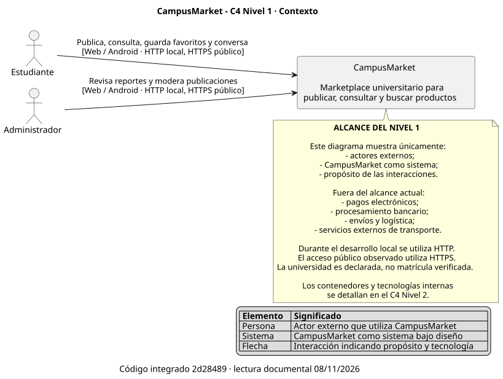

# C4 Nivel 1 - Contexto de CampusMarket



Vista generada con PlantUML 1.2026.1/Smetana; el archivo `.puml` sigue siendo la fuente canónica. [Reproducción y verificaciones](../evidencias/auditoria-documental-s1-s14-2026-11-08.md#validación-documental-reproducible).

El diagrama de contexto vigente de CampusMarket se mantiene como
**diagrama como código** en:

[`01-contexto.puml`](./01-contexto.puml)

Lectura actualizada al código `2d28489`: incluye Favoritos y conversaciones
sin añadir actores ni sistemas externos. La universidad es declarada, no una
identidad verificada. El [modelo anterior al 8/nov](https://github.com/ISCOUTB/AS_202620_PROYECTO_CAMPUSMARKET/blob/2d2848922db799389ffdcf0db4ef50437cd27ef2/docs/c4/01-contexto.puml)
se conserva en Git; no se reescribe la evidencia de S2/S4.

---

## Propósito

El C4 Nivel 1 representa a **CampusMarket como un único sistema** e identifica
las personas y elementos externos que interactúan con él.

En este nivel no se muestran:

- contenedores;
- módulos;
- componentes;
- clases;
- tecnologías internas de persistencia.

Su objetivo es responder principalmente:

- quién utiliza CampusMarket;
- para qué interactúa con el sistema;
- cuál es el límite del sistema bajo diseño.

---

## Actores externos

### Estudiante

Miembro de la comunidad universitaria que utiliza CampusMarket para:

- publicar productos;
- consultar productos;
- buscar productos disponibles.

### Administrador

Usuario responsable de supervisar publicaciones y apoyar la gestión del
contenido disponible en CampusMarket.

---

## Sistema bajo diseño

**CampusMarket** es un marketplace universitario orientado a centralizar la
publicación, consulta y búsqueda de productos dentro de la comunidad
universitaria.

En el C4 Nivel 1 se representa como una única caja.

Los detalles internos se documentan en niveles posteriores del modelo C4.

---

## Relaciones principales

- **Estudiante → CampusMarket:** publica, consulta y busca productos mediante
  Flutter Web o Android; se registra/inicia sesión para gestionar sus productos.
- **Administrador → CampusMarket:** supervisa publicaciones y contenido
  mediante Flutter Web o Android con capacidad de moderación habilitada.

Durante el desarrollo local del prototipo la comunicación utiliza HTTP.

El uso de HTTPS corresponde a un posible despliegue externo y no se presenta
como una capacidad ya implementada en el entorno local.

---

## Alcance

Actualmente se mantienen fuera del alcance materializado:

- pagos electrónicos;
- procesamiento bancario;
- envíos y logística;
- integración con empresas externas de transporte.

No se representan sistemas externos adicionales porque todavía no forman parte
del corte vertical implementado.

---

## Relación con C4 Nivel 2

El C4 Nivel 1 representa CampusMarket como un único sistema.

El:

[C4 Nivel 2 - Contenedores](./02-contenedores.md)

realiza un acercamiento al interior de CampusMarket.

La arquitectura vigente del Nivel 2 conecta Flutter Web/Android con un backend
FastAPI mediante HTTP/JSON, Bearer y multipart. Los repositories del backend
acceden a MySQL mediante PyMySQL; el contexto Publicaciones conserva fotografías
en archivos y metadatos en su tabla propia.

Los contenedores vigentes son:

* **Frontend Web/Android** — Flutter / Dart;
* **Backend API** — FastAPI / Python;
* **Persistencia** — MySQL.

La persistencia mediante SQLite utilizada durante el primer corte forma parte de
la historia arquitectónica del proyecto y no representa el estado vigente.

Su tratamiento histórico permanece documentado mediante:

[ADR-0002 - Manejo de bloqueo temporal de SQLite](../adr/0002-manejo-bloqueo-sqlite.md)

La migración hacia MySQL se registra mediante:

[ADR-0004 - Migrar la persistencia de SQLite a MySQL](../adr/0004-migrar-persistencia-a-mysql.md)

---

## Evolución arquitectónica

El cambio:

```text
SQLite → MySQL
```

no altera el alcance del C4 Nivel 1.

Los actores continúan siendo:

* Estudiante;
* Administrador.

CampusMarket continúa representándose como un único sistema frente a esos
actores.

La modificación afecta únicamente la estructura interna mostrada a partir del
C4 Nivel 2.

---

## Fuente canónica

El archivo:

[`01-contexto.puml`](./01-contexto.puml)

es la fuente versionada y vigente del C4 Nivel 1.

Cualquier modificación gráfica debe realizarse sobre ese archivo para evitar
versiones contradictorias.

La documentación Markdown complementa el diagrama, pero no reemplaza la fuente
PlantUML.
