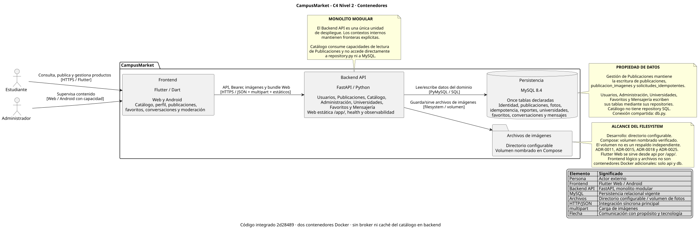

# C4 Nivel 2 - Contenedores de CampusMarket

Vista generada con PlantUML 1.2026.1/Smetana; el archivo `.puml` sigue siendo la fuente canónica. [Reproducción y verificaciones](../evidencias/auditoria-documental-s1-s14-2026-11-08.md#validación-documental-reproducible).

Fuente canónica: [02-contenedores.puml](02-contenedores.puml).
El backend conserva una única unidad de ejecución FastAPI (ADR-0001).

| Pieza | Tecnología y responsabilidad | Correspondencia |
|---|---|---|
| Frontend | Flutter/Dart, Web y Android; catálogo, identidad, publicaciones, favoritos, conversaciones y moderación | `frontend/campusmarket/lib/` |
| Backend API | Python 3.12/FastAPI; siete contextos, contrato y autorización | `backend/app/` |
| Base de datos | MySQL 8.4; once tablas declaradas con escritor por contexto | [Propiedad y límite de la guarda automática](../arc42/08-conceptos-transversales.md#84-propiedad-de-datos) |
| Archivos | Fotos verificadas/reencodificadas; referencia en MySQL | `publicaciones/image_storage.py`, `CAMPUSMARKET_UPLOAD_DIR` |

Estudiantes consultan públicamente y se autentican para publicar, gestionar su
contenido o reportar. Moderadores comprobados revisan reportes, ocultan o descartan
con nota. El frontend usa HTTP/JSON síncrono y multipart; las operaciones protegidas
incluyen Bearer. La exposición pública vigente utiliza HTTPS.

Contrato vigente: [OpenAPI v2](../../contracts/openapi-v2.json), API 2.0.0.
`test_contrato_openapi.py` compara FastAPI con ese archivo. v1 se conserva como historia.

## Persistencia y fronteras

Los routers delegan en sus services y estos en sus repositories. `db.py` comparte
la conexión/transacción. Usuarios escribe usuarios/sesiones/intentos;
Publicaciones escribe publicaciones/fotos; Administración escribe reportes.
Catálogo lee a través del servicio de Publicaciones. Administración solicita
ocultamiento por ese servicio y no escribe sus tablas.

Los archivos se sirven públicamente desde `/uploads`; las mutaciones de galería
requieren propietario autenticado. ADR-0015 exige decodificación/reencodificación,
nombres aleatorios, límites de tamaño/píxeles y limpieza al eliminar.

## Topología institucional y alcance actual

El frontend **lógico** se ejecuta en el navegador/Android; su bundle Web está
alojado en `api` y se sirve por `/app/`. API y MySQL siguen en los dos contenedores
Docker `api` y `db`. El directorio de fotos es un volumen, no un servicio adicional.
La promoción del 3/nov y sus límites se describen en [la evidencia productiva](../evidencias/cierre-productivo-incremento2-2026-11-03.md).
El 8/nov, `/app/` y `/docs` responden HEAD 200, `/health` GET 200 y
`/universidades` GET 500; no se afirma otra aceptación UI ni inventario físico
de tablas/montajes. [Auditoría y separación de revisiones](../evidencias/auditoria-documental-s1-s14-2026-11-08.md).

## Registro histórico de topología pública y medición — 4/oct/2026

Flutter Web está publicado en GitHub Pages:
https://nnigarp.github.io/AS_202620_PROYECTO_CAMPUSMARKET/.
Su bundle consume https://campusmarket.iscoutb.dev por HTTPS. Ese dominio expone
la API FastAPI en Dokploy; /health y /docs responden HTTP 200. MySQL y las fotos
permanecen en los volúmenes nombrados del Compose de ADR-0018.

API y MySQL tienen 256 MiB/0,5 CPU por contenedor y la API un worker.
CI recrea ambos contenedores y mide EC-01 con 1000 filas reales mediante HTTP
loopback/MySQL bajo cuota. Este resultado no equivale a latencia de navegador
público. El registro público de recreación acredita API, no recreación de MySQL.

Frontend fuente c38e0cf; API observada 7856416; repositorio auditado b5f10a2.
El código relevante es idéntico entre esas revisiones; sus resultados se citan
por separado en el [complemento S9](../evidencias/evidencia-s9-2026-10-01.md#17-complemento-final-de-auditoria-s9--4-de-octubre-de-2026).
Pages → Azure App Service → Azure MySQL se conserva como línea base histórica S8.

Véanse [C4 Nivel 3](03-componentes-backend.md), [arc42 despliegue](../arc42/07-vista-despliegue.md)
y [auditoría de continuación](../evidencias/auditoria-mvp-continuacion-2026-10-03.md).

## Lectura S12 — Consistencia, caché y eventos (2026-10-25)

En el [diagrama fuente](02-contenedores.puml), MySQL continúa como contenedor de persistencia diferenciado del Backend y el almacenamiento de imágenes figura como contenedor de archivos. Catálogo consume el servicio de Publicaciones en el mismo proceso FastAPI, **sin una réplica asíncrona**. La revisión de reportes y las mutaciones se apoyan en transacciones MySQL; SQL y filesystem no forman una transacción atómica conjunta. **No se agrega Redis ni broker al C4**: S12 optó por no cachear lecturas mutables en el backend ni introducir eventos productivos. El chat HTTP y la caché privada de Favoritos de Flutter son posteriores y se distinguen en [arc42 §8](../arc42/08-conceptos-transversales.md). Un cambio de infraestructura requeriría actualizar el modelo y su justificación antes de atribuirle operatividad.

Véase [tabla de operaciones y caché S12](../evidencias/evidencia-s12-2026-10-25.md), [arc42 §8](../arc42/08-conceptos-transversales.md) y [ADR-0022](../adr/0022-mantener-mysql-como-fuente-de-verdad-y-evitar-proyecciones-asincronas.md).

## Adenda C4 L2 — despliegue institucional vigente (2026-11-01)

La descomposición **lógica** del sistema continúa siendo Flutter → FastAPI (monolito modular) → MySQL, con fotografías persistidas fuera de MySQL. La **ubicación física** vigente cambia: el frontend Flutter Web compilado se sirve como recurso estático desde el propio contenedor `api` de FastAPI por `/app/`. No es un microservicio nuevo ni constituye un tercer contenedor. Traefik dirige HTTPS de `campusmarket.iscoutb.dev` a `api:8000`. `api` consulta `db:3306` y utiliza los volúmenes `publication_images` y `mysql_data` según corresponde; el navegador no conecta directamente a MySQL.

Esta adenda complementa los diagramas previos que representan otras fechas o plataformas, sin borrarlos. [arc42 §7](../arc42/07-vista-despliegue.md#7-nueva-topología-institucional-vigente--2026-11-01-adenda), [ADR-0025](../adr/0025-servir-flutter-web-con-fastapi-en-servicio-existente.md), [evidencia](../evidencias/cierre-web-institucional-2026-11-01.md).
